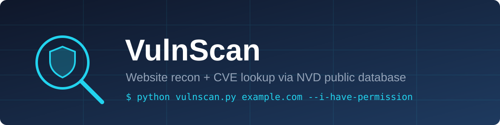
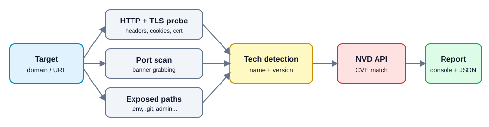
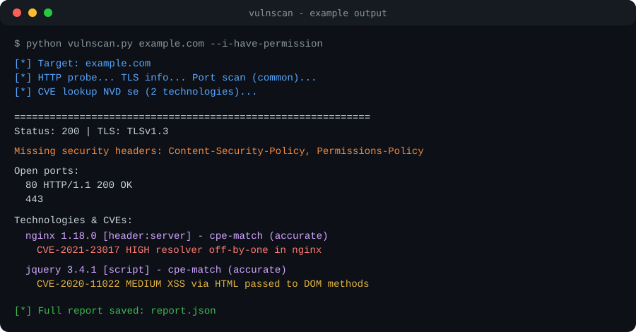

<p align="center">
  
</p>

<p align="center">
  
  
  
  
</p>

**VulnScan** ek Python tool hai jo kisi website ki technology stack detect karta hai aur detected versions ko **NVD (National Vulnerability Database)** ke public CVE data se match karke known vulnerabilities report karta hai.

> ⚠️ **Legal notice:** Is tool ko sirf apni websites ya un systems par use karo jinke liye tumhare paas **written permission** hai. Bina permission scan karna illegal ho sakta hai. Author kisi misuse ke liye zimmedar nahi hai.

## Features

- DNS/IP resolution, HTTP headers aur cookie flags (`Secure`, `HttpOnly`)
- Missing security headers (CSP, HSTS, X-Frame-Options, etc.)
- TLS version aur certificate expiry
- Technology + version detection (Server, X-Powered-By, meta generator, JS libraries, service banners)
- Port scan (common ports ya 1-1024) with banner grabbing
- Exposed sensitive paths check (`/.env`, `/.git/HEAD`, `/phpinfo.php`, `/admin` ...)
- CVE lookup NVD API 2.0 se, CVSS score aur severity ke saath
- JSON report export

## How it works

<p align="center">
  
</p>

## Installation

```bash
git clone https://github.com/OxClub/ox-scanner.git
cd ox-scanner
pip install -r requirements.txt
```

## Usage

```bash
# Basic scan
python vulnscan.py example.com --i-have-permission

# Full port range (1-1024), more CVEs, custom report name
python vulnscan.py https://example.com --i-have-permission --ports full --max-cves 20 --out myreport.json

# Skip port scan
python vulnscan.py example.com --i-have-permission --ports none
```

| Option | Description | Default |
|---|---|---|
| `target` | Domain ya URL | required |
| `--i-have-permission` | Confirm karo ki tum authorised ho | required |
| `--ports` | `common`, `full`, `none` | `common` |
| `--max-cves` | Har software ke liye max CVEs | `10` |
| `--out` | JSON report ka path | `report.json` |

### NVD API key (optional, recommended)

Bina key ke NVD requests rate-limited hoti hain (~6 sec wait per lookup). Free key yahan se lo: <https://nvd.nist.gov/developers/request-an-api-key>

```bash
# Linux / macOS
export NVD_API_KEY=your_key_here

# Windows (PowerShell)
$env:NVD_API_KEY="your_key_here"
```

Key kabhi code ya repo mein commit mat karo.

## Example output

> Ye ek illustrative example hai, real scan result nahi.

<p align="center">
  
</p>

## Limitations

- Detection version strings par depend karta hai. Agar server version hide karta hai, to CVE match nahi hoga.
- Version-based match ka matlab **"vulnerable ho sakta hai"**, confirmed exploit nahi. Backported patches (Debian/Ubuntu/RHEL) ki wajah se false positives aate hain. Findings ko manually verify karo.
- Ye active exploitation tool nahi hai. Ye sirf recon aur known-CVE matching karta hai.
- Full scanners (Nmap, Nuclei, OpenVAS) ki jagah nahi leta.

## Contributing

Pull requests welcome hain. Naye software ke liye `CPE_MAP` mein entry add karna sabse aasan contribution hai.

## License

MIT - dekho [LICENSE](LICENSE). (LICENSE mein `YOUR NAME` replace kar dena.)

## Credits

CVE data: [NIST National Vulnerability Database](https://nvd.nist.gov/). Ye project NVD ya NIST se endorsed nahi hai.
